# Семейное меню — инструкция пользователя

**Версия программы: 0.8.1 · 12 ноября 2026 г.**

Программа хранит рецепты, составляет меню из трёх блюд в день на семь дней и рассчитывает КБЖУ и продукты для готовки. Работает локально; интернет нужен для загрузки рецепта по ссылке и открытия его источника.

В руководстве — настоящие снимки работающей версии с учебными рецептами. Красные номера добавлены только для пояснения: в обычном окне их нет. Снимки сделаны в Linux; оформление рамок, шрифтов и системных диалогов в Windows отличается, названия и действия кнопок совпадают. Показанные меню и числовые значения — примеры работы, а не готовый рацион для вашей семьи.

[Онлайн-версия на GitHub](https://github.com/Glaciatus/NJ-cooking/blob/main/docs/USER_GUIDE_RU.md) · [HTML для открытия в браузере](USER_GUIDE_RU.html) · [PDF](USER_GUIDE_RU.pdf)

## Быстрый старт: первая неделя

1. Распакуйте **всю** папку программы, включая `data`. При запуске из исходников установите Python 3.12 с Tcl/Tk и запустите `start_windows.bat`. Другой вариант — команда `py -3 app.py` из папки проекта. Для готового Windows-приложения запускается `NJ-Cooking.exe` из успешно собранного архива Actions.
2. На вкладке **«1. Базы и рецепты»** выберите, какие базы участвуют. Встроенная база уже содержит 13 703 рецепта; подтверждать каждую запись не нужно. Личная база хранится отдельно.
3. При желании отметьте несколько конкретных рецептов в столбце **«В меню»**: каждый должен встретиться хотя бы раз.
4. На вкладке **«2. Семья и цели КБЖУ»** задайте число людей и порций, цели, режим, желаемые типы и исключения.
5. Для проверки среднего за неделю выберите **«Недельный баланс»** и включите **«Обязательный контроль КБЖУ»**. Без этой галочки цели остаются пожеланиями, а рецепты с неполным КБЖУ допускаются.
6. Нажмите **«Составить меню на неделю →»**. Если появится вариант с отклонениями, изучите величины и примите его либо отмените.
7. На вкладке **«4. Меню»** просматривайте дни и блюда, при необходимости заменяйте или переставляйте их.
8. На вкладке **«3. Итоги и покупки»** найдите недельный список продуктов и сохраните отчёт кнопкой **«Сохранить меню (.txt)»**.

Если элементы не помещаются, разверните окно и прокрутите форму справа. Кнопка составления меню на вкладке 2 закреплена внизу. Для знакомства с интерфейсом можно добавить учебные рецепты кнопкой **«Примеры»**.

## 1. Базы: откуда брать рецепты

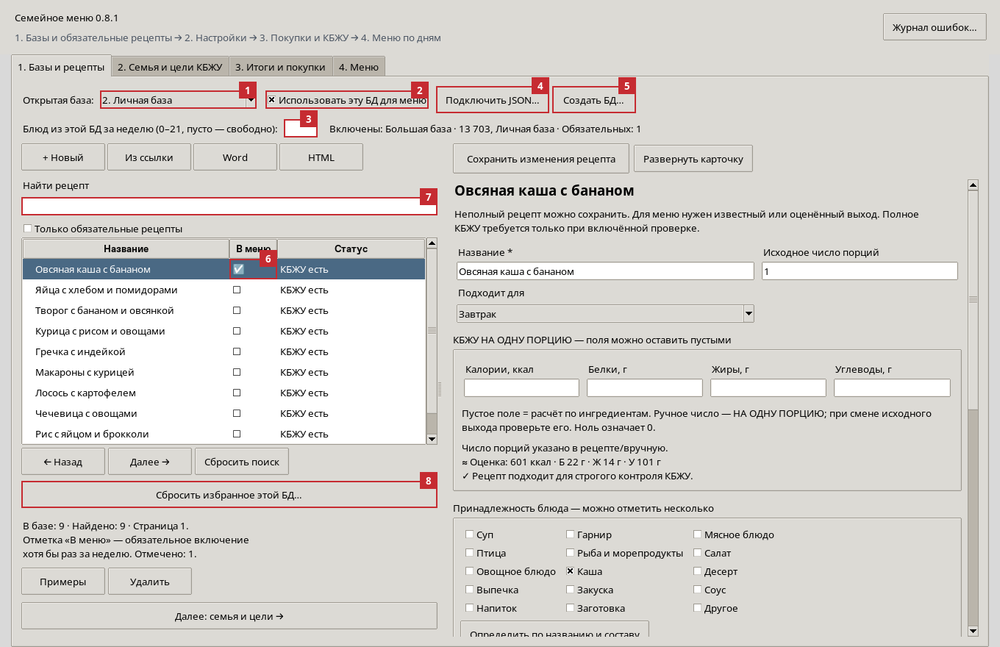

| № на снимке | Элемент | Что делать и что произойдёт |
|---|---|---|
| 1 | Открытая база | Выберите базу для просмотра и редактирования. Само открытие не включает и не отключает её для подбора. |
| 2 | Использовать эту БД для меню | Включает эту базу в новый подбор. Снимите галочку, чтобы не брать из неё блюда. Рецепты и обязательные отметки сохраняются. |
| 3 | Блюд из этой БД за неделю | Точная квота позиций из 21. Пусто — свободное количество; 0 — не брать; 10 — ровно десять позиций, включая повторы. |
| 4 | Подключить JSON… | Подключает существующую базу рецептов в формате NJ-Cooking: JSON-массив записей, например личную базу с другого ПК. |
| 5 | Создать БД… | Создаёт отдельный JSON-файл рецептов. Вы выбираете имя и расположение файла. |
| 6 | Столбец «В меню» | Щелчок по ячейке или пробел на выбранной строке переключает обязательное включение рецепта хотя бы раз за неделю. |
| 7 | Найти рецепт | Поиск по названию внутри открытой базы. Для большого списка есть страницы по 300 записей. |
| 8 | Сбросить избранное этой БД… | Снимает обязательные отметки только в открытой базе после подтверждения. Сами рецепты не удаляет. |

**Пример квот:** большая база — 11, личная — 10. Получится 21 позиция. Если квоты заданы для всех доступных баз, их сумма должна быть ровно 21. Повтор одного блюда дважды занимает две позиции.

**Только личная база:** откройте большую базу и снимите галочку № 2; затем откройте личную и оставьте её включённой. Для её квоты укажите 21 или оставьте поле пустым.

**«Только обязательные рецепты»** скрывает в списке остальные записи, но не делает всю базу недоступной для подбора. **«Сбросить поиск»** очищает поиск и этот фильтр; избранные отметки остаются.

Обязательные рецепты имеют приоритет над фильтром желаемых типов блюд. Остальные условия продолжают действовать: исключённые продукты, известный выход, полнота КБЖУ при контроле, квоты и пределы выбранного режима. Снять обязательную отметку — разрешить программе обойтись без блюда, а не удалить его.

Статусы в списке: **«КБЖУ есть»** — данных достаточно для контроля; **«Неполное КБЖУ»** — можно использовать без обязательного контроля; **«Нет выхода»** — нужно уточнить порции или состав для оценки выхода.

## 2. Добавление и карточка рецепта

На вкладке 1 доступны следующие способы добавления:

| Кнопка | Действие |
|---|---|
| + Новый | Открывает пустую карточку для ручного ввода. |
| Из ссылки | Загружает рецепт с поддерживаемой страницы сайта. |
| Word | Импортирует один или несколько рецептов из `.docx`. |
| HTML | Читает сохранённую HTML-страницу рецепта без загрузки сайта. |
| Примеры | Добавляет учебные рецепты, которых ещё нет в выбранной пользовательской базе. |
| Удалить | Удаляет выбранную запись из пользовательской базы либо скрывает её во встроенной. Сначала прочитайте подтверждение. |

Если открыта большая встроенная база, новые рецепты и импорты добавляются в **личную**. Если открыта другая пользовательская база — в неё. Рецепты можно сохранять неполными и дорабатывать позже. Импорт не означает, что все поля распознаны без ошибок: проверьте выход, количества и единицы.

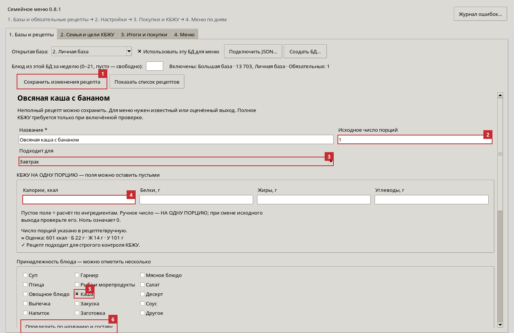

| № | Элемент | Как использовать |
|---|---|---|
| 1 | Сохранить изменения рецепта | Записывает карточку в её базу. Также работает Ctrl+S на вкладке 1. Изменённые поля сами по себе ещё не означают сохранение. |
| 2 | Исходное число порций | Сколько порций получается из **всех продуктов карточки**. Например, 400 г крупы в рецепте на четыре порции — это не 400 г на человека. |
| 3 | Подходит для | «Любой», «Завтрак», «Обед» или «Ужин». Ограничивает место блюда при автоматическом подборе. |
| 4 | Поля КБЖУ | Введите значения **на одну исходную порцию**. Остальные поля того же ряда — белки, жиры и углеводы. Пустое поле рассчитывается по ингредиентам, если данных достаточно. |
| 5 | Принадлежность блюда | Отметьте один или несколько тегов: например, каша, гарнир, суп. Теги и время приёма пищи — разные настройки. |
| 6 | Определить по названию и составу | Повторно определяет теги автоматически. Проверьте результат и сохраните карточку. |

**«Развернуть карточку»** скрывает левый список, чтобы форма была шире. В развёрнутом состоянии кнопка называется **«Показать список рецептов»**. Нижние поля доступны прокруткой.

Калории указываются в ккал, Б/Ж/У — в граммах. **Пусто не равно нулю:** пустое поле допускает автоматический расчёт; введённый `0` означает именно ноль. Можно вручную заполнить часть показателей, а остальные оставить для расчёта.

Если вручную введено КБЖУ на порцию и вы меняете исходное число порций, проверьте КБЖУ отдельно: программа сохраняет ваши явные числа и не делит их повторно. Ссылка на источник, доступные ссылки на фото/видео и авторские значения на 100 г сохраняются при редактировании.

## 3. Продукты, приготовление и источник

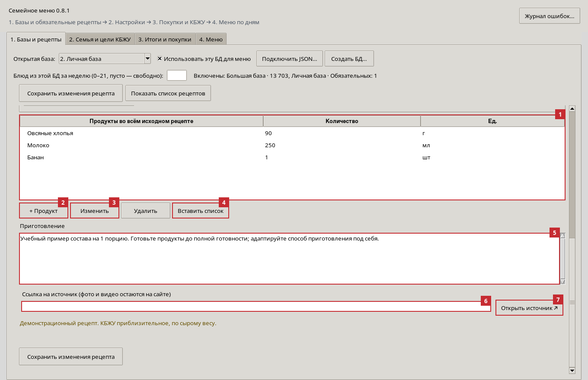

| № | Элемент | Что делает |
|---|---|---|
| 1 | Список продуктов | Количества относятся ко всему исходному рецепту. Выберите строку перед изменением или удалением продукта. |
| 2 | + Продукт | Открывает форму нового ингредиента. |
| 3 | Изменить | Открывает выбранный ингредиент. То же действие — двойной щелчок по строке. |
| 4 | Вставить список | Добавляет продукты из многострочного текста. Удобный формат: `Рис; 400; г`, по одному продукту на строку. |
| 5 | Приготовление | Текст шагов рецепта, который затем отображается в меню. |
| 6 | Ссылка на источник | Адрес исходного рецепта, который сохраняется в карточке и отчёте. |
| 7 | Открыть источник ↗ | Открывает адрес в браузере: там можно посмотреть фото, видео и пояснения автора. |

Кнопка **«Удалить» в строке действий продуктов** удаляет только выбранный ингредиент. Кнопка «Удалить» под библиотекой относится к рецепту целиком. После правок состава сохраните рецепт.

### Форма отдельного продукта

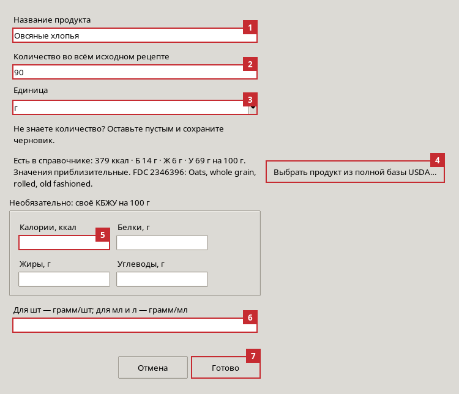

| № | Элемент | Что вводить |
|---|---|---|
| 1 | Название продукта | Например, «Овсяные хлопья». Если меняете название, прежнее явное соответствие USDA может быть сброшено: проверьте справочник снова. |
| 2 | Количество | Число во всём исходном рецепте. Для рецепта на четыре порции с 400 г крупы укажите 400. |
| 3 | Единица | Например, г, кг, мл, л, шт, ст. л. или ч. л. |
| 4 | Выбрать продукт из полной базы USDA… | Позволяет вручную связать этот ингредиент с конкретной записью справочника. |
| 5 | Своё КБЖУ на 100 г | Полностью заполните все четыре поля или оставьте все пустыми. Ручные данные продукта имеют приоритет над справочником. |
| 6 | Масса единицы | Для штук — грамм в одной штуке; для мл/л — плотность в г/мл. Например, яйцо 50 г/шт. Это не поле общей массы рецепта. |
| 7 | Готово | Применяет изменения ингредиента к открытой карточке. Затем сохраните сам рецепт кнопкой на рисунке 2. |

Количество можно оставить неизвестным для черновика. Тогда числовая сумма покупок будет неполной. Если КБЖУ блюда введено вручную, оно может быть известно, хотя количество отдельной приправы неизвестно.

### Как выбрать запись USDA

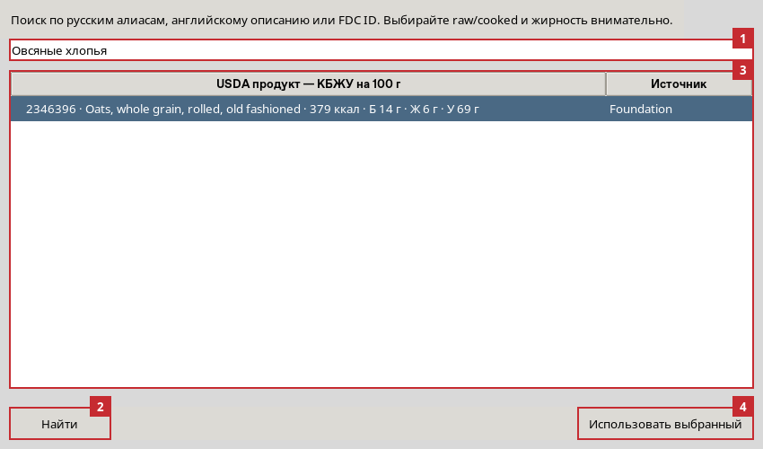

| № | Элемент | Действие |
|---|---|---|
| 1 | Поиск | Введите известное русское название, английское описание или FDC ID. Не для каждого русского названия существует готовое соответствие. |
| 2 | Найти | Обновляет результаты поиска. Можно нажать Enter. |
| 3 | Результаты | Выберите нужную строку. Значения показаны на 100 г. Сравните состав, жирность и состояние: raw — сырой, cooked — приготовленный. |
| 4 | Использовать выбранный | Закрепляет соответствие за ингредиентом. Затем нажмите «Готово» в форме продукта и сохраните рецепт. |

Встроенный справочник содержит 8 202 записи USDA. Он используется локально, без API-ключа и интернета. Выбор сухого риса вместо варёного или молока другой жирности заметно меняет результат.

## 4. Импорт из сайта, Word и сохранённой страницы

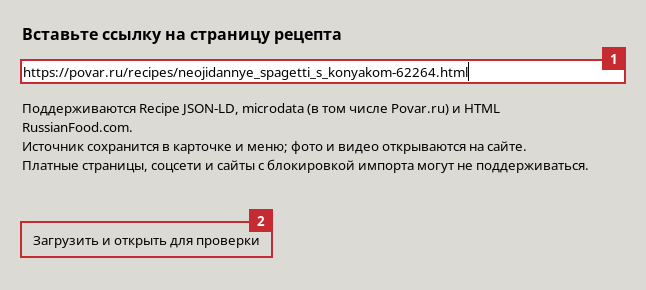

| № | Элемент | Действие |
|---|---|---|
| 1 | Адрес страницы | Вставьте ссылку на **конкретный рецепт**, а не главную страницу или поисковую выдачу сайта. |
| 2 | Загрузить и открыть для проверки | Программа загружает страницу, извлекает продукты, порции, приготовление и доступные метаданные, добавляет рецепт и открывает карточку. Проверьте результат и сохраните правки. |

Поддерживаются рецепты schema.org Recipe в JSON-LD и microdata; добавлен разбор Povar.ru и RussianFood.com. Сайт с JSON-LD, например eda.rambler.ru, может поддерживаться общей логикой, но работа с любой страницей не гарантируется. Проверка Povar.ru и RussianFood.com выполнена на предоставленных сохранённых страницах; авторизация, блокировка загрузки или изменение вёрстки могут мешать импорту по сети.

**Если ссылка не загружается:** сохраните страницу в браузере как HTML и попробуйте кнопку **«HTML»** на вкладке 1. Программа читает сам HTML-файл, не исполняя его скрипты. Исходная ссылка определяется из страницы; при отсутствии программа предложит её указать. Не каждая сохранённая страница содержит полный текст рецепта: иногда сайт подгружает его отдельно.

Авторское **КБЖУ на 100 г** хранится с явной подписью отдельно. Его нельзя без пересчёта переносить в поля «на порцию». Если автор не указал КБЖУ порции, программа использует расчёт по составу или ваши ручные данные.

**Word:** выбирайте `.docx`. Поддерживаются заголовки рецептов, разделы «Ингредиенты»/«Продукты»/«Состав», «Приготовление» и строки вроде «Порций: 4». В одном документе может быть несколько рецептов. Старый формат `.doc` предварительно сохраните как `.docx`. Необычная вёрстка требует проверки: нераспознанный текст сохраняется для уточнения.

## 5. Семья и цели КБЖУ

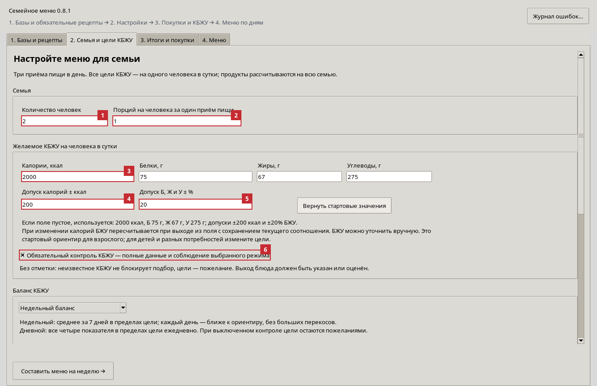

| № | Элемент | Значение |
|---|---|---|
| 1 | Количество человек | На сколько людей рассчитывать продукты. Не умножает целевое КБЖУ на человека. |
| 2 | Порций на человека за один приём пищи | Общий множитель порции для всех блюд меню. `1` — одна исходная порция; `0,5` — половина; `1,5` — полторы. |
| 3 | Цели КБЖУ | Весь ряд — ккал, белки, жиры, углеводы **на одного человека за сутки**. После изменения калорий БЖУ пересчитывается с сохранением текущего соотношения; затем можно изменить граммы вручную. |
| 4 | Допуск калорий | Абсолютный допуск в ккал. Например, цель 2000 и допуск 200 — диапазон 1800–2200. |
| 5 | Допуск Б, Ж и У | Процент для каждого из трёх показателей. Белок 75 г ±20% — диапазон 60–90 г. |
| 6 | Обязательный контроль КБЖУ | Включён — используются полные данные и проверяется выбранный режим. Выключен — неполные данные допустимы, а попадание в цели не гарантируется. |

При пустых полях используются стартовые значения: **2000 ккал, Б 75 г, Ж 67 г, У 275 г**, допуски ±200 ккал и ±20% БЖУ; семья — 2 человека, множитель порции — 1. **«Вернуть стартовые значения»** возвращает цели, допуски и дневные границы недельного режима к начальным значениям; число людей, режим и фильтры остаются выбранными.

Это общий стартовый ориентир для взрослого. Программа не рассчитывает индивидуальную потребность по возрасту, росту, весу или активности и не различает потребности отдельных членов семьи. При изменении калорий и выходе из поля (либо перед подбором) БЖУ автоматически пересчитывается с сохранением текущих долей энергии. Используется энергия `E = 4 × Б + 9 × Ж + 4 × У`, затем каждый показатель умножается на `новые калории / E` и округляется до 0,1 г. Например, стартовые цели при 1600 ккал дадут примерно Б 59,9 г, Ж 53,5 г, У 219,7 г. После этого граммы можно уточнить вручную. Сохранённые пользовательские цели при загрузке не нормализуются заново; изменение дневной цели не меняет КБЖУ карточек рецептов.

## 6. Недельный баланс, дневной режим и фильтры

Прокрутите вкладку 2 ниже.

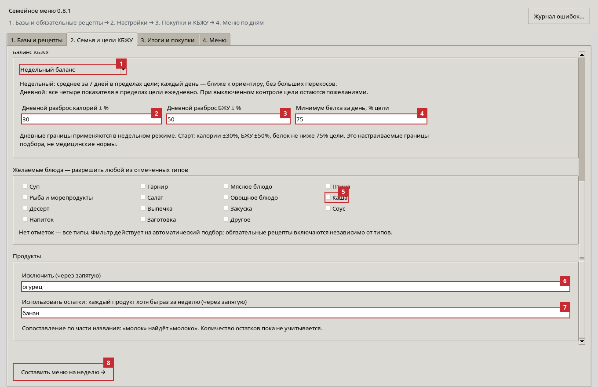

| № | Элемент | Как работает |
|---|---|---|
| 1 | Режим КБЖУ | «Недельный баланс» — контролируется среднее за семь дней плюс отдельные дневные границы. «Строгий дневной» — все четыре целевых диапазона ежедневно. |
| 2 | Дневной разброс калорий | Широкие дневные границы для недельного режима. При 2000 ккал и 30% — 1400–2600 ккал за день. |
| 3 | Дневной разброс БЖУ | Дневные границы для каждого макронутриента в недельном режиме. Это отдельный параметр от допуска среднего на рисунке 7. |
| 4 | Минимум белка за день | Дополнительный нижний предел белка в процентах цели. При 75 г и 75% — минимум 56,25 г за день. Если нижняя граница БЖУ выше, действует она. |
| 5 | Желаемые блюда | Разрешаются рецепты с **хотя бы одним** из отмеченных тегов. Без отметок разрешены все типы. Это фильтр, а не требование включить каждый отмеченный тип. |
| 6 | Исключить | Названия продуктов через запятую. Автоматический подбор не использует рецепты с совпадающими ингредиентами. |
| 7 | Использовать остатки | Каждый указанный продукт должен встретиться хотя бы в одном блюде недели. Количество имеющегося остатка пока не учитывается. |
| 8 | Составить меню на неделю → | Новый подбор из всех включённых баз по текущим настройкам. Заменяет принятую текущую неделю результатом нового подбора. |

**Недельный режим выбран по умолчанию для нового подбора.** При включённом контроле среднее за семь дней должно попадать в цели с допусками рисунка 7. Каждый отдельный день обязан оставаться в более широких границах рисунка 8. Подбор также предпочитает варианты ближе к дневным ориентирам, чтобы уменьшать колебания.

Например, для цели 2000 ккал ±200 недельный итог должен быть 12 600–15 400 ккал **на человека**, то есть среднее 1800–2200. При дневном разбросе ±30% каждый день отдельно должен быть в пределах 1400–2600 ккал. Хорошее среднее не разрешает день с 800 ккал или белком ниже установленного минимума.

В строгом дневном режиме диапазон 1800–2200 ккал проверяется **каждый день**, без компенсации другим днём. Поля широких дневных границ недельного режима тогда не используются. Если обязательный контроль выключен, режим и цели остаются ориентирами: соответствие не гарантируется.

Исключения и остатки сопоставляются по части названия без учёта регистра и ё/е. Например, «молок» найдёт «молоко». Это не полноценное распознавание всех словоформ и скрытых ингредиентов. Обязательные рецепты обходят положительный фильтр типов, но не исключения продуктов. Узкий набор типов может не дать составить завтрак, обед или ужин.

Числовые дневные границы — настройки поиска, не медицинские нормы. Размеры отдельных блюд программа автоматически под КБЖУ не оптимизирует: она выбирает и сочетает рецепты с заданным общим множителем порции.

## 7. Просмотр и изменение готовой недели

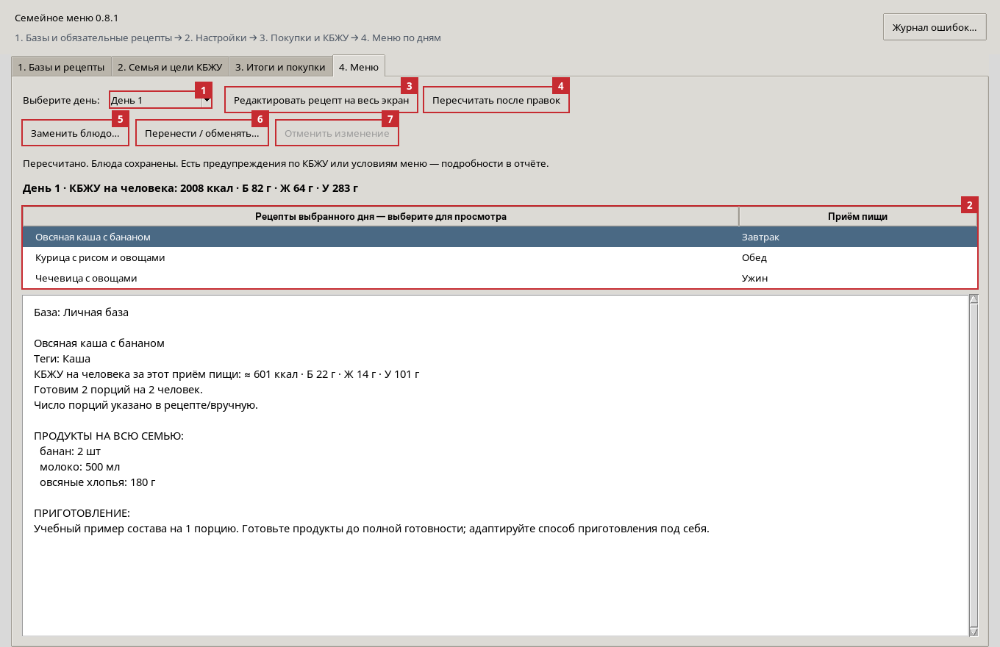

| № | Элемент | Действие |
|---|---|---|
| 1 | Выберите день | Переключает один из семи дней. |
| 2 | Рецепты выбранного дня | Выберите завтрак, обед или ужин. В большом поле ниже появятся состав на семью, приготовление, КБЖУ и источник. |
| 3 | Редактировать рецепт на весь экран | Открывает выбранный рецепт в развёрнутой карточке на вкладке 1. |
| 4 | Пересчитать после правок | После сохранения карточки обновляет КБЖУ и покупки, сохраняя все 21 позицию и их порядок. |
| 5 | Заменить блюдо… | Выбор другого рецепта для этой позиции с предварительным просмотром. |
| 6 | Перенести / обменять… | Перемещение блюда между днями и приёмами пищи либо обмен двух блюд. |
| 7 | Отменить изменение | Возвращает прежнюю расстановку после ручной замены/перемещения. Кнопка неактивна, пока отменять нечего. |

История хранит до **20 ручных изменений** в текущем сеансе. Она очищается при новом подборе и не сохраняется после закрытия. Отмена расстановки не возвращает старые значения карточки: при пересчёте используются актуальные сохранённые данные рецепта.

Одно блюдо не может повторяться в пределах дня: такой вариант нельзя применить. Названия сравниваются без учёта регистра и ё/е, в том числе между базами. Это правило действует также при автоматическом подборе и принятии варианта с отклонениями. Повторы между разными днями разрешены. Старые сохранённые недели не удаляются: при наличии повторов показывается предупреждение; новый подбор строит дни без повторов.

После допустимой ручной замены или перестановки покупки и КБЖУ пересчитываются автоматически. Если нарушены цели, дневные границы, обязательные рецепты, квоты или фильтры, программа показывает предупреждения, но оставляет ваше ручное решение. Проверяйте их, особенно если заменили обязательное блюдо или выбрали блюдо с исключённым продуктом.

### Замена блюда

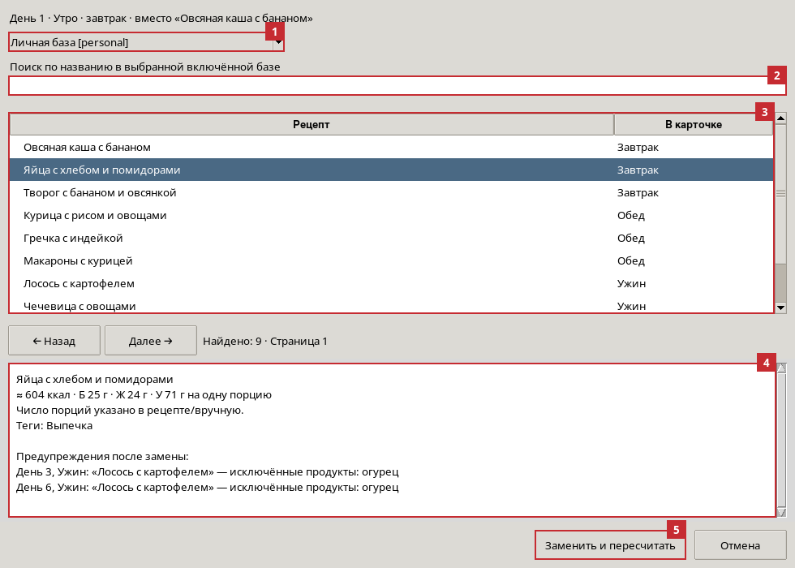

| № | Элемент | Действие |
|---|---|---|
| 1 | База | Выберите одну из включённых баз. Отключённые источники здесь не предлагаются. |
| 2 | Поиск | Ищет по названию в выбранной базе. |
| 3 | Рецепты | Щёлкните по подходящей записи. Для большого списка есть страницы по 100 результатов. |
| 4 | Предварительный просмотр | Показывает КБЖУ на исходную порцию, выход, теги и предупреждения для будущего меню. |
| 5 | Заменить и пересчитать | Применяет замену, пересчитывает отчёт и покупки, сохраняет неделю. «Отмена» закрывает окно без изменения. |

### Перенос и обмен

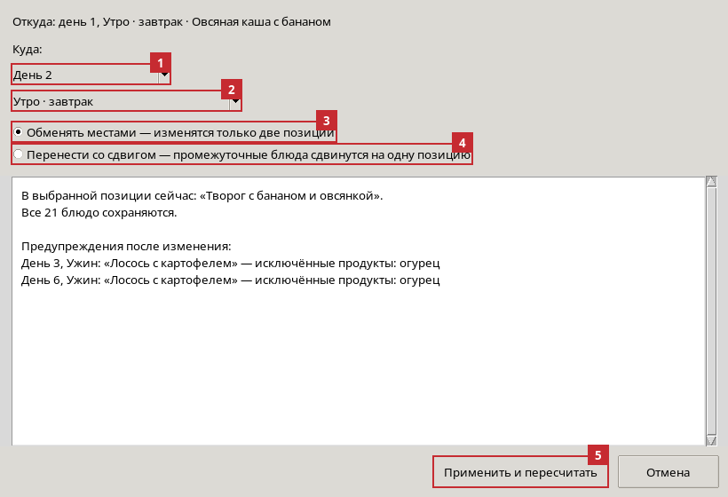

| № | Элемент | Действие |
|---|---|---|
| 1 | День назначения | Укажите, в какой день поставить выбранное блюдо. |
| 2 | Приём пищи назначения | Выберите утро/завтрак, день/обед или вечер/ужин. |
| 3 | Обменять местами | Меняет только исходную и выбранную позиции; остальные 19 остаются на месте. |
| 4 | Перенести со сдвигом | Вставляет выбранное блюдо в новое место; все промежуточные позиции в порядке недели сдвигаются на одну. Все 21 блюдо сохраняются. |
| 5 | Применить и пересчитать | Сохраняет расстановку и обновляет расчёты. До нажатия проверьте предупреждения в окне. |

При обычном обмене/переносе без изменения состава блюд недельные количества продуктов и суммарное КБЖУ остаются прежними, а дневные итоги меняются. Поэтому даже при сохранённом недельном балансе может появиться нарушение дневной границы.

## 8. Итоги, покупки и три разных способа пересчёта

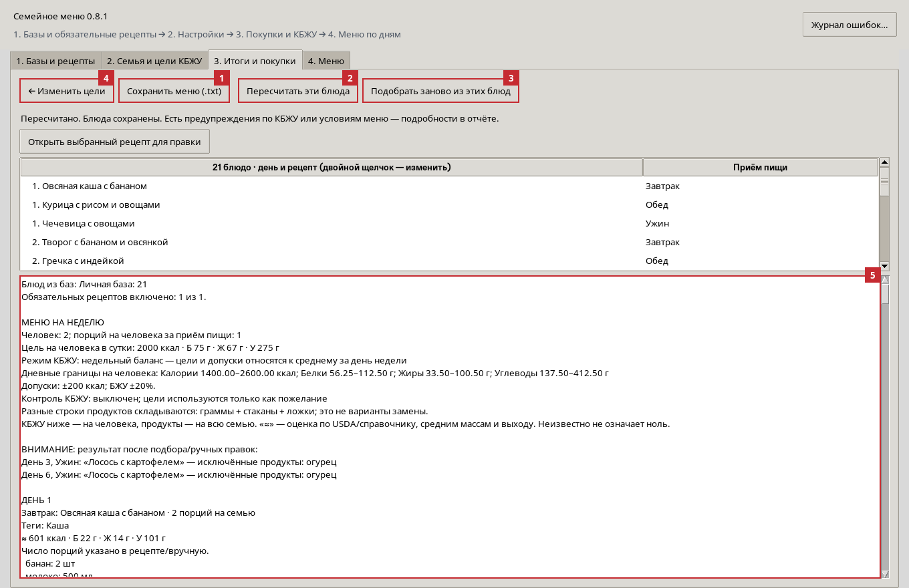

| № | Элемент | Действие |
|---|---|---|
| 1 | Сохранить меню (.txt) | Экспортирует текущий текстовый отчёт: меню, КБЖУ, продукты и источники. Формат UTF-8, не Word и не отдельный Excel-файл. |
| 2 | Пересчитать эти блюда | Обновляет текущие блюда по сохранённым карточкам, сохраняет порядок и прежние параметры меню. |
| 3 | Подобрать заново из этих блюд | Делает новый подбор **только из уникальных рецептов текущей недели** с их актуальными данными. Может менять порядок и повторы. |
| 4 | ← Изменить цели | Возвращает на вкладку 2. Для применения новых целей к новому подбору затем нажмите «Составить меню». |
| 5 | Отчёт | Прокручивайте до раздела «СПИСОК ПОКУПОК НА НЕДЕЛЮ». Выше показаны предупреждения, блюда, КБЖУ и продукты по дням. |

**Что выбрать после правки рецепта:**

1. Откройте карточку, исправьте данные и **сохраните**.
2. Если устраивают блюда и их порядок — **«Пересчитать эти блюда»** или **«Пересчитать после правок»**.
3. Если хотите заново распределить блюда внутри прежнего набора — **«Подобрать заново из этих блюд»**.
4. Если хотите использовать всю библиотеку или новые цели — **«Составить меню на неделю →»** на вкладке 2.

Повторный подбор из выборки использует сохранённые цели, режим и фильтры прежней недели, но текущие включённые базы, обязательные отметки и квоты. Он не заменяет новый подбор из всей библиотеки. Если изменённый набор несовместим с условиями, результата может не быть.

После сохранения изменённого рецепта существующий отчёт считается устаревшим, и экспорт временно отключается до пересчёта. Простое изменение настроек на вкладке 2 не перестраивает уже принятую неделю.

## 9. Если не удалось соблюсти КБЖУ

Если контролируемый подбор не нашёл неделю, программа пробует подготовить вариант с отклонениями, сохранив остальные условия. Поиск ограничен, поэтому такой вариант не обязательно математически ближайший.

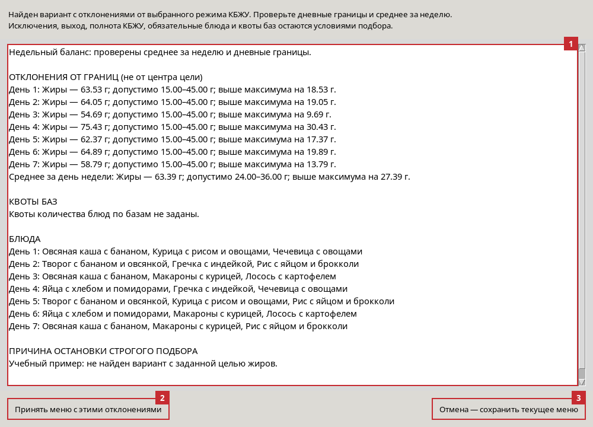

| № | Элемент | Что проверить |
|---|---|---|
| 1 | Отклонения | День или среднее за неделю, показатель, фактическое значение, допустимый диапазон и выход **за границу допуска**. Ниже показаны квоты баз и блюда. |
| 2 | Принять меню с этими отклонениями | Делает предложенный вариант текущей неделей, обновляет покупки и отчёт. Отклонения сохраняются в отчёте; контроль в настройках не выключается. |
| 3 | Отмена — сохранить текущее меню | Оставляет ранее принятую неделю без изменений. |

Пример: жиры 36,30 г при допустимых 24–36 г — превышение **на 0,30 г**, а не на 6,30 г относительно центральной цели 30 г. В недельном режиме отдельно проверяются среднее за неделю и широкие дневные границы.

В предварительном варианте могут быть нарушены и недельные, и дневные ограничения. Исключённые продукты, полнота КБЖУ, выход, обязательные блюда и квоты баз автоматически не отменяются. Если не удаётся выполнить и эти условия, вместо предложения появится ошибка.

**Почему большая база не гарантирует результат:** рецептов много, но после фильтрации по выходу, полноте КБЖУ, типам и исключениям может остаться мало. Обязательное блюдо нельзя автоматически заменить другим. Например, порция с 73 г жиров не поместится в дневную границу 45 г даже при идеальных остальных днях. Можно уточнить неверные данные, снять обязательную отметку, изменить размер порции или осознанно пересмотреть границы.

Поиск сочетаний ограничен по объёму работы. Сообщение «не найдено в пределах поиска» не доказывает, что решения нет вообще.

## 10. Какие расчёты выполняются

### Масштабирование продуктов на семью

Обозначения: `N` — число людей; `P` — порций на человека за приём; `S` — исходный выход рецепта; `Q` — количество продукта во всём рецепте.

**Порций для семьи = N × P.**

**Количество продукта на приготовление = Q × N × P / S.**

Пример: исходно 400 г крупы на четыре порции. Семья из трёх человек, по 1,5 порции: нужно 4,5 порции, крупы `400 × 3 × 1,5 / 4 = 450 г`.

Этот пересчёт выполняется для каждого ингредиента блюда, затем формируются суммы на день и неделю. Программа не вычитает автоматически остатки из холодильника и не округляет покупки до упаковок магазина.

### КБЖУ продукта и блюда

1. Количество ингредиента по возможности переводится в граммы: кг умножаются на 1000; для штук используется масса штуки, для жидкостей — плотность, для ложек и стаканов — подходящие меры.
2. **КБЖУ ингредиента = масса в граммах × КБЖУ на 100 г / 100.**
3. Для каждого показателя отдельно суммируются данные всех ингредиентов и делятся на исходное число порций `S`.
4. Если показатель блюда введён вручную, именно это значение на порцию имеет приоритет. Ручные данные продукта на 100 г имеют приоритет над его справочными данными.

Пример: продукт 200 г, на 100 г — 100 ккал, Б 5 г, Ж 2 г, У 15 г. Во всём количестве будет 200 ккал, Б 10 г, Ж 4 г, У 30 г. Если это весь состав на две порции, одна порция — 100 ккал, Б 5 г, Ж 2 г, У 15 г.

Приоритет справочников: собственное КБЖУ ингредиента → выбранная/известная запись USDA → локальный справочник. Если состав или масса недостаточно известны, показатель остаётся неизвестным. Неизвестный ингредиент не превращается в нулевой вклад. Авторские значения на 100 г готового блюда сохраняются отдельно и автоматически не подменяют показатели порции.

### КБЖУ приёма пищи, дня и недели

- **На человека за приём = КБЖУ исходной порции × P.**
- **На человека за день = сумма трёх приёмов пищи.**
- **На человека за неделю = сумма семи дней.**
- **Среднее за день недели = недельная сумма / 7.**

Например, при 500 ккал на исходную порцию и множителе `P = 1,5` получится 750 ккал на человека за этот приём. Число членов семьи не меняет эту величину; оно увеличивает продукты на готовку. Семейный итог КБЖУ в отчёте не выводится.

Калории, белки, жиры и углеводы проверяются отдельно. При известных калориях используются значения источника или расчёта состава: программа не заставляет их точно совпасть с выражением `4 × Б + 9 × Ж + 4 × У`. Если калории не удалось получить из состава, но известны все три БЖУ порции, калории оцениваются именно по этой формуле и помечаются как оценка. Если цели противоречат друг другу, подбор может не найти сочетание.

### Если не указаны исходные порции

Программа оценивает категорию блюда, съедобную массу ингредиентов и выход после приготовления, затем делит его на типовую массу порции. Например, для супа используется ориентир 350 г, гарнира — 180 г. Учитываются усреднённое впитывание воды крупами и потери массы при готовке; уже указанная вода повторно не добавляется.

Оценка помечается **«≈»** с объяснением. Она не равна лабораторному измерению и не означает автоматические «две порции» для всех рецептов. Для заготовок и неоднозначного состава выход может остаться неизвестным. Такой рецепт не используется в автоматическом меню до уточнения выхода.

Если вы знаете фактическое число порций, введите его в карточке: ручной выход имеет приоритет. При ручном КБЖУ порции проверьте согласованность обоих значений.

### Единицы, оценки и список покупок

Для штук, ложек, стаканов и жидкостей используются доступные меры USDA, средние массы и плотности. Ручная масса единицы позволяет их уточнить. `стакан` соответствует объёму 250 мл, `cup` — 236,588 мл; масса зависит от продукта. Диапазоны количества из встроенной базы могут храниться как отмеченные средние оценки с сохранённым исходным текстом.

**Разные строки покупок складываются, а не заменяют друг друга.** Запись «мука 2490 г», «мука 3,6 стакана», «мука пшеничная 6 ст. л.» означает всё перечисленное вместе. Программа не объединяет автоматически разные названия и несовместимые единицы в один вес. Для единого итога в граммах сначала приведите названия и количества в карточках к согласованному виду.

Неизвестные количества вынесены в раздел **«НЕ ВКЛЮЧЕНО В ЧИСЛОВУЮ СУММУ»**. Их нужно добавить к покупкам вручную или уточнить в рецепте. Когда КБЖУ известно частично, отчёт может показать известную часть отдельно: это не полный итог недели.

## 11. Сохранение, перенос и обновление

Принятая неделя, настройки и базы сохраняются локально. Обычно пользовательские файлы Windows находятся здесь:

```text
%LOCALAPPDATA%\NJ-cooking
```

| Файл | Содержимое |
|---|---|
| `personal-recipes.json` | Личная база рецептов. |
| `bundled-overrides.json` | Ваши правки и скрытые записи большой базы. Исходная база находится в папке программы `data`. |
| `databases.json` | Подключённые базы, участие, квоты и обязательные отметки. |
| `settings.json` | Сохранённые цели, режим и фильтры подбора. |
| `menu.json` | Текущая принятая неделя и её параметры. |
| `logs/nj-cooking.log` | Журнал диагностики. |

Копируйте пользовательскую папку **и отдельно все подключённые внешние JSON-файлы**, если переносите программу на другой компьютер. Подключённые базы остаются по выбранным вами путям; при переносе могут потребоваться новые пути. Перед перезаписью существующего файла программа сохраняет резервную копию `.json.bak`.

Для обновления закройте программу, скачайте свежий ZIP репозитория и распакуйте его в новую папку целиком. Пользовательскую папку не удаляйте. Обновление кода не требует повторного одобрения встроенных рецептов. Старые меню, сохранённые до появления недельного режима, пересчитываются с прежними дневными правилами, пока вы не выполните новый подбор.

## 12. Частые ситуации и журнал ошибок

| Ситуация | Что проверить |
|---|---|
| Не вижу нужного рецепта | Открытую базу, поиск, фильтр «Только обязательные» и номер страницы. |
| Рецепт виден, но не выбирается | Участие базы, квоту, выход, КБЖУ при контроле, типы, время приёма, исключённые продукты. |
| Включил только личную базу, но подбор не идёт | Есть ли в ней блюда для всех трёх приёмов; не осталось ли конфликтующих квот или обязательных отметок. |
| Все поля КБЖУ пустые | Это допустимый черновик. Для расчёта нужны известные ингредиенты и массы либо ручное КБЖУ порции. |
| Слишком большой выход или странное КБЖУ | Проверьте исходные порции, количество всего рецепта, г/кг и мл/л, массу штуки, сырой/готовый продукт USDA, значения на 100 г и на порцию. |
| Поправил рецепт, а отчёт прежний | Сохраните карточку и нажмите «Пересчитать после правок» или «Пересчитать эти блюда». |
| Изменил цели, но старая неделя не поменялась | Нажмите «Составить меню» на шаге 2: пересчёт старой недели сохраняет её прежние параметры. |
| В меню повторяется блюдо | Повторы в разные дни разрешены, но в пределах одного дня запрещены. Подбор не обещает 21 уникальное блюдо за неделю. |
| Не загружается ссылка | Проверьте адрес, доступность сайта и сертификаты; попробуйте сохранённый HTML. Не отключайте проверку TLS ради импорта. |
| Ошибка запуска `.exe` | Попробуйте запуск через установленный Python. Готовый exe берите из успешно завершённой Windows-сборки, распакуйте архив. |

Кнопка **«Журнал ошибок…»** находится справа в шапке программы, на всех вкладках. Она показывает версию и путь к файлу:

```text
%LOCALAPPDATA%\NJ-cooking\logs\nj-cooking.log
```

После ошибки закройте программу и передайте этот файл для диагностики. Если событие было раньше, могут понадобиться соседние файлы `.1`–`.3`. В журнале есть версия, настройки, названия обязательных/выбранных блюд и сведения о поиске; полные тексты рецептов и переменные окружения не копируются. Автоматической отправки журнала нет.

## Что программа пока не делает

Не составляет отдельные нормы для каждого члена семьи, не оптимизирует автоматически разные размеры порций для отдельных блюд, не учитывает остатки продуктов по весу и упаковки магазина, не гарантирует отсутствие повторов или нахождение любого математически возможного меню. Не поддерживает любую страницу любого сайта и не распознаёт все русские названия продуктов. Автоматические порции, массы и КБЖУ являются оценками, которые можно уточнять вручную.
